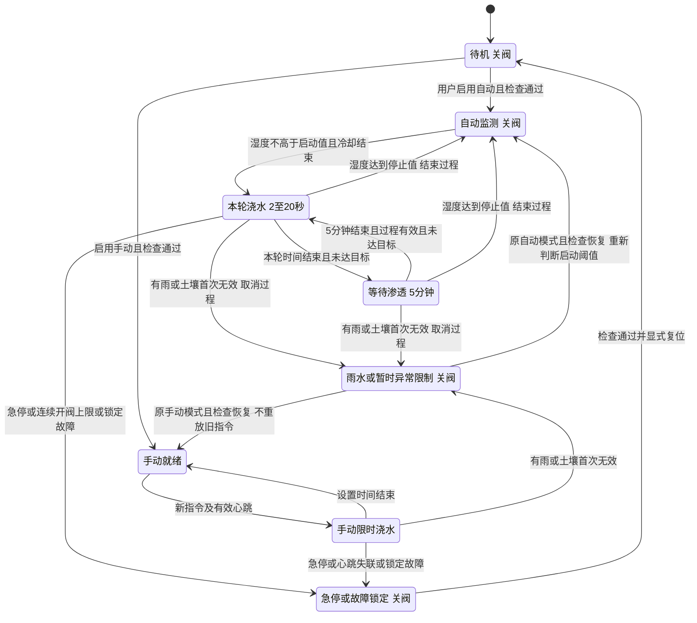
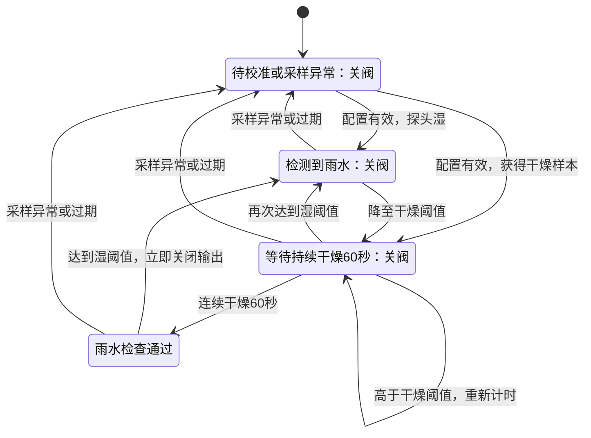
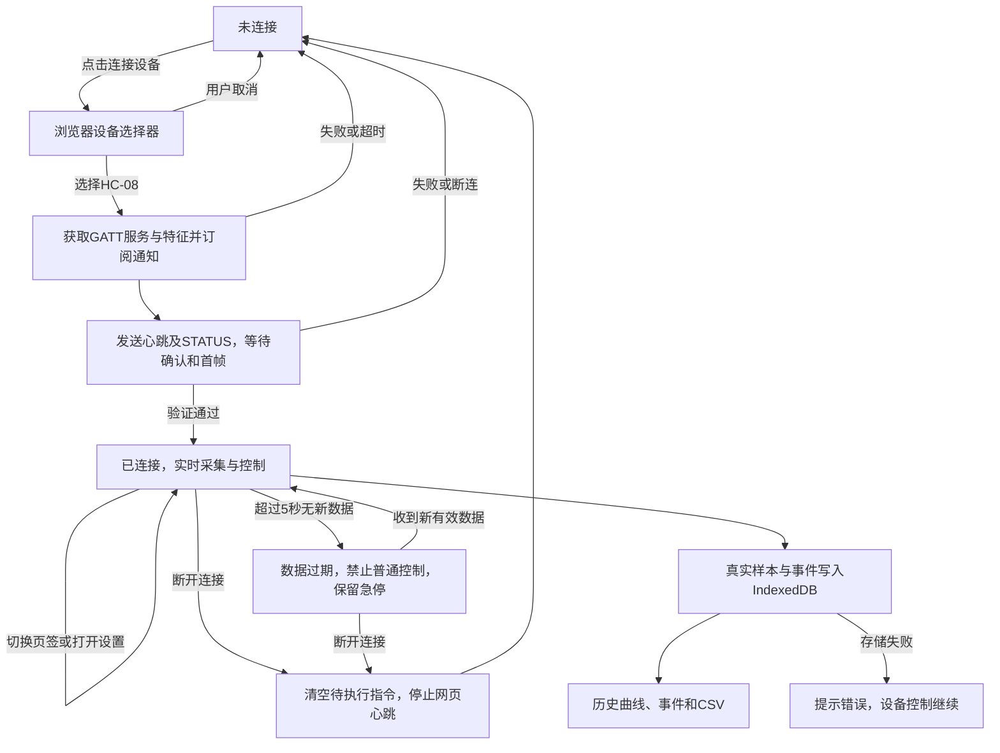

# 单区智慧灌溉：功能与工作逻辑清单

对应经典 Nano ATmega328P、HC-08 和单区电磁阀。固件入口为 `firmware/smart_irrigation`，网页分为实时监控、历史记录两个页签。详细烧录与协议说明见 [项目首页](../README.md)。

## 1. 功能概览

| 模块 | 功能 |
|---|---|
| 采集 | 每秒读取土壤、温度、光照；雨水每250ms读取；每路8次平均，保留ADC |
| 换算 | 湿度%=(700−ADC)/3；温度°C=ADC×5/1023×100；照度lux≈(18×ADC/(1023−ADC))^1.5 |
| 控制 | 自动灌溉、手动限时、冷却、异常停水、急停与复位 |
| 通信 | 串口打包数据，经HC-08蓝牙发送；接收网页命令并确认 |
| 网页 | 实时读数、控制、设置、历史曲线、事件与CSV导出 |
| 存储 | 浏览器保存真实记录；断连留空，存储失败不阻断控制 |

## 2. 配件接口接入表

以下为当前代码对应的接法。传感器数量各1个；供电电压按实物模块规格确认，模拟输出不得超过Nano ADC输入范围。

| 配件 | 配件端接口 | 接入位置 | 用途 |
|---|---|---|---|
| 电容式土壤传感器 | AO；VCC/GND | AO→Nano A0；VCC→匹配电源，GND→Nano GND | 读取土壤模拟值 |
| 光照模块 | AO；VCC/GND | AO→Nano A1；VCC→匹配电源，GND→Nano GND | 读取光照模拟值 |
| 模拟温度模块 | AO；VCC/GND | AO→Nano A2；VCC→匹配电源，GND→Nano GND | 按线性温度换算公式换算 |
| 雨水模块 | AO；VCC；GND | AO→Nano A3；VCC→5V；GND→Nano GND | 实测干燥0、沾湿≥400；雨水保护已启用 |
| HC-08 | TXD（发送） | →Nano D8（软件串口RX，接收） | 网页命令进入Nano |
| HC-08 | RXD（接收） | ←电平转换/分压←Nano D9（软件串口TX，发送） | Nano数据发往网页 |
| HC-08 | VCC；GND | VCC→模块允许的电源；GND→Nano GND | 供电与信号参考地 |
| 状态LED | 正极；负极 | D6→限流电阻→LED正极；负极→GND | 工作状态指示 |
| 继电器模块 | IN；VCC/GND | IN←Nano D3；按模块规格接供电/地 | 控制阀电源，当前高电平有效 |
| 常闭直流电磁阀 | 两根电源线 | 阀电源正极→继电器COM，NO→阀正端，阀另一端→电源负极 | 继电器释放时阀断电 |
| Nano | USB | 电脑USB | 供电、烧录、串口调试 |

配套还需：匹配阀电压/电流的独立电源、继电器/驱动、续流保护、LED限流电阻、电平转换器件及连接线。阀不接GPIO供电；带极性/内置保护的阀按标识接线。继电器控制侧接地按模块隔离方式确认。

### 蓝牙为什么接D8/D9，而不是板上的RX/TX？

TX表示发送，RX表示接收；D0、D1、D8、D9是引脚编号。**串口功能和D编号可以对应同一个引脚。**

| Nano串口 | RX接收脚 | TX发送脚 | 当前用途 |
|---|---|---|---|
| 硬件串口 `Serial` | D0（板上RX） | D1（板上TX） | USB调试与烧录；程序调试波特率115200 |
| 软件串口 `bluetooth`（AltSoftSerial） | D8 | D9 | HC-08通信，9600波特 |

所以当前必须交叉连接：**HC-08 TXD→D8/RX；D9/TX→电平转换→HC-08 RXD**。D8/D9仍在传输UART串口数据，由AltSoftSerial利用定时器实现，不是普通高低电平开关控制。

也可以改用硬件串口D0/D1，但必须同步修改程序及波特率，并处理与板载USB转串口电路、烧录和调试的共用问题，不能只换接线。当前方案保留独立USB调试通道。AltSoftSerial在ATmega328P上固定用D8/D9并占用Timer1，不能随意改成其他D脚。

依据：[AltSoftSerial引脚说明](https://www.pjrc.com/teensy/td_libs_AltSoftSerial.html)、[Nano官方引脚手册](https://docs.arduino.cc/resources/datasheets/A000005-datasheet.pdf)，并已核对本项目及已安装库的定义。

## 3. 同一串口如何发送四种传感器数据？

传感器接A0/A1/A2/A3，由Nano采样、换算；随后把四路读数放进同一条消息，串口按字节依次发送。网页按字段位置拆开，就能在三张卡片中一起更新，无需四组TX/RX。

```text
土壤AO→A0 ─┐
光照AO→A1 ─┼→Nano采样、换算、拼成一帧→D9/TX→电平转换→HC-08 RXD→BLE→网页
温度AO→A2 ─┤
雨水AO→A3 ─┘
网页控制命令→BLE→HC-08 TXD→D8/RX→Nano控制程序
```

下面是已确认干燥且就绪的V3数据帧示例，不是实测数据。发送末尾追加换行符 `\n`：

```text
D,3,42,65000,550,50,64,3128,650,-1,3,0,0,0,0,30,45,1,0,0,0,1,0,2,0,0
```

| 帧中位置（从D算第1项） | 示例值 | 网页解释 |
|---|---:|---|
| 第6项：土壤相对湿度 | 50 | 50%（土壤ADC为550） |
| 第8项：温度×100 | 3128 | 31.28°C（温度ADC为64） |
| 第9项：光照ADC | 650 | 估算175.7 lux；ADC仅在设置显示 |
| 第21～23项：雨水 | 0,1,0 | ADC0、未下雨、确认完成 |

第10项保留V1相对光照字段，当前为-1；网页lux从第9项计算，不将百分比当成lux。土壤湿度限制0～100%，沿用整数协议，舍去小数。光照故障或ADC为1023时不换算；历史曲线及CSV也采用同一估算公式。

其他字段携带原始ADC、序号、运行时间、有效标志及控制状态。逗号分隔字段，换行分隔消息；蓝牙通知即使分多次到达，网页也先缓存，收齐一行再校验、解析和更新。

“同时显示”来自同一轮采样的数据一起更新；线路上的字节按顺序传输。9600波特、8N1格式下理论约960字节/秒；当前固件按每字节至少1.25毫秒调度，192字节约需0.24秒，加上主循环调度、蓝牙与浏览器延迟。程序还把同一帧发送到USB调试串口，便于核对。

## 4. 配置与控制要点

| 项目 | 当前行为 |
|---|---|
| 开阀前提 | 执行器验证、土壤校准通过，连续3次有效且采样新鲜，雨水已校准且持续干燥60秒，无锁定 |
| 默认配置 | ACTUATOR_VERIFIED=true、SOIL_CALIBRATED=true；RAIN_CONFIGURED=true，采用实测0/400端点 |
| 待对照 | 700/400参考端点需核对实际探头；估算lux需与照度计对照 |
| 温度配置 | 按线性公式直接启用，参考电压5.0V、系数100°C/V；需对照温度计验证，超出V1的125°C上限标记异常 |
| 自动模式 | ≤30%启动、≥45%停止；每次关闭后限制下一次自动启动5分钟 |
| 手动模式 | 默认5秒，可设1～30秒；重复指令不延长，手动不受自动冷却限制 |
| 停水保护 | 连续开阀60秒锁定；手动浇水5秒无心跳锁定 |
| 雨水限制 | 湿即停水；持续干燥60秒解除，中途再湿重计；自动还需满足湿度和冷却，手动不恢复旧指令 |
| 雨水异常 | 未校准或采样异常/过期禁止开阀；复位不能绕过雨水检查 |
| 土壤异常 | 一次无效立即关闭，连续3次异常或采样3.5秒过期锁定 |
| 设置与复位 | 阈值仅关阀时可改，重启恢复默认；排查并恢复有效采样后显式复位 |

HC-08供电、驱动额定值及上电/复位时的关闭电平仍需实测核实。土壤为相对湿度，光照为近似照度；电压检查不能识别所有传感器故障。

## 5. 工作逻辑状态转移图

模式编号仍为待机0、自动1、手动2。自动模式新增补水过程及分轮等待，所有开阀与复位条件包括雨水检查。完整公式见[综合灌溉算法](irrigation-algorithm.md)。




雨水保护独立作用于自动和手动输出；检测到雨水不触发急停锁定，也不切换模式。所有模式均受雨水限制；任何模式下的急停和锁定故障都进入锁定状态，切换模式先关闭并取消旧过程。



检查通过仅解除雨水限制：自动模式还须湿度≤启动值、冷却结束；手动需新指令。上电同样需要确认60秒。雨水阻断期间D6快闪；继电器测试LED表示输出，与D6状态灯用途不同。

补充规则：切换模式先关闭输出；选择待机不清除已有锁定。复位成功回到待机，不恢复旧浇水。自动模式独立于网页运行；温度/光照异常只标记对应故障。

| 状态 | 阀门输出 | LED |
|---|---|---|
| 待机且检查通过 | 关闭 | 灭 |
| 自动监测/冷却、手动就绪 | 关闭 | 慢闪 |
| 自动或手动浇水 | 开启 | 常亮 |
| 雨水限制、配置未通过、控制故障或急停 | 关闭 | 快闪 |

温度/光照异常时快闪优先，阀门仍按土壤控制规则运行。页面显示控制输出，没有阀位或流量反馈。

## 6. 网页连接流程图



重连只同步当前状态，不重放旧开阀指令。切换页签不会中断采集；历史仅显示和导出真实记录。

## 7. 验收清单

- [x] 本仓库的网页构建、36项单元测试、12项浏览器测试通过（2026-10-23），详见[测试记录](testing.md)。
- [x] 覆盖控制、急停、断连、历史兼容、存储失败及三种屏幕宽度。
- [x] 固件控制测试、默认/全启用配置Nano编译通过。
- [x] 雨水停水、持续干燥60秒、再次变湿、过期、复位门禁和计时回绕软件验证。
- [x] 参考测量值雨水干燥ADC0、沾湿≥400，已启用配置。
- [ ] 实地验证滴水停水、干燥恢复和自动冷却联动，见[校准步骤与灌溉公式](rain-calibration.md)。
- [ ] 核实模块供电、驱动与阀电源，完成土壤/光照校准、温度对照和默认关闭测试。
- [ ] 实测传感器变化2秒内显示，阀门启停、故障复位及手动失联停水正确。
- [ ] 完成十次真实重连、CSV核对及受控24小时运行。

浏览器测试使用BLE替身，加速24小时测试只验证控制逻辑；实物项目仍待验收。
